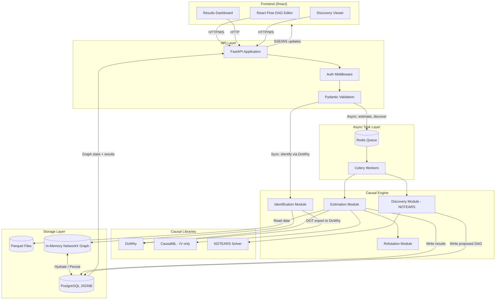
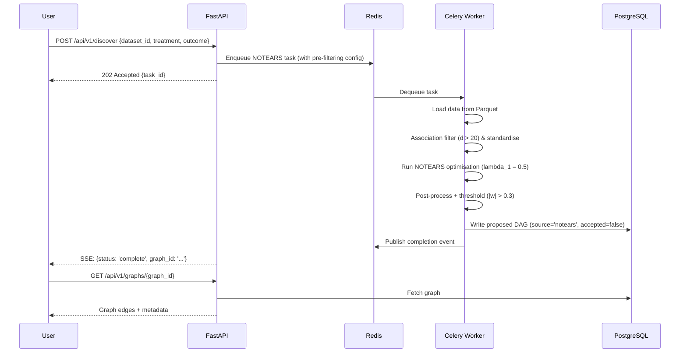
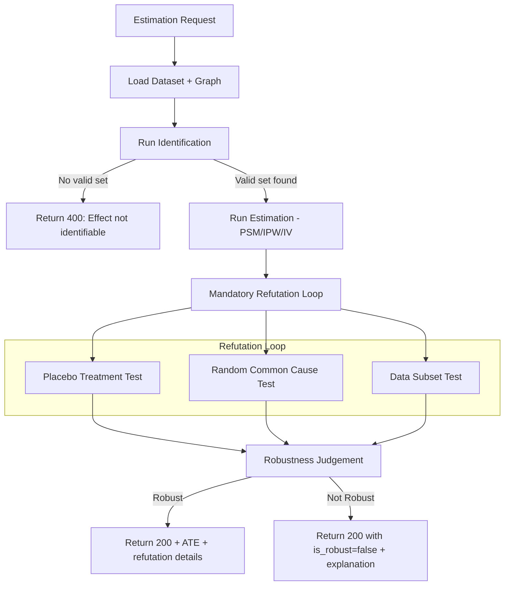
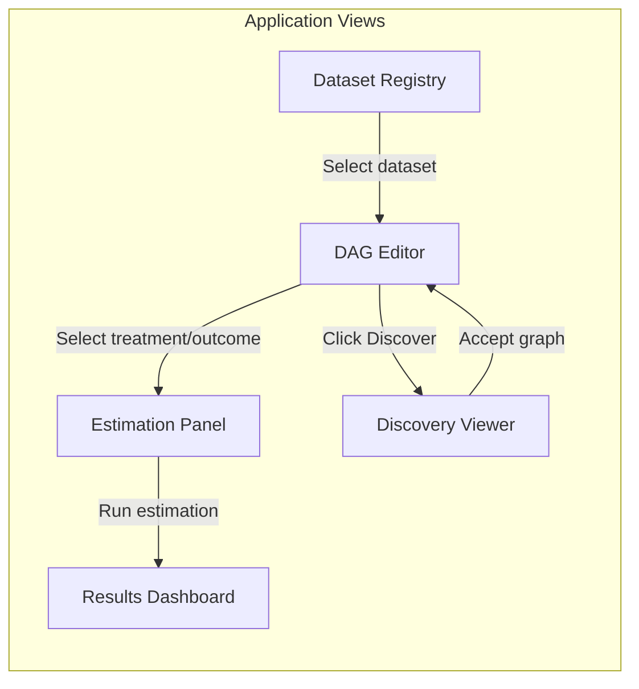
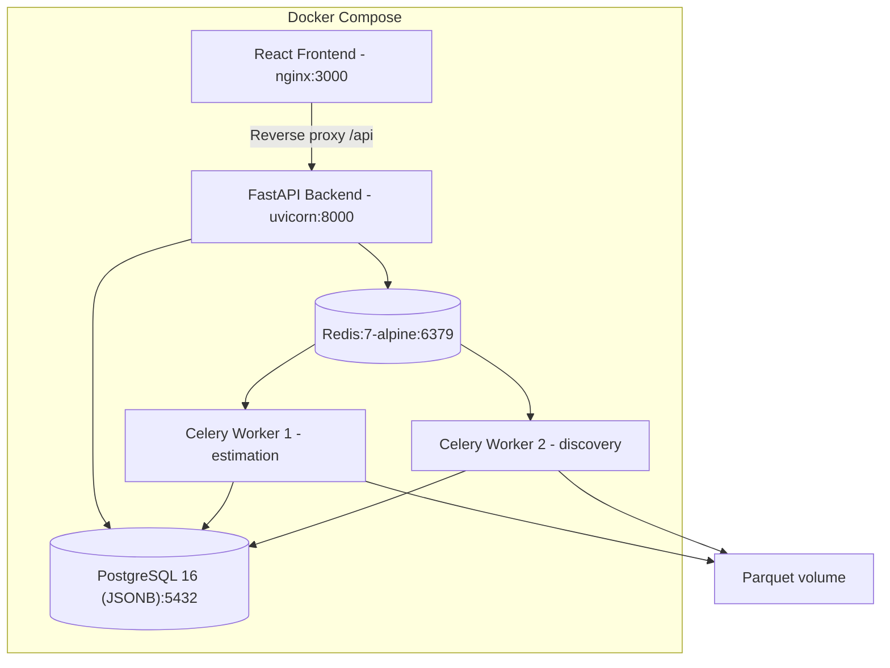

# CausalForge: Enterprise Causal Discovery & Decision Platform — Architecture and Design

| | |
|---|---|
| **Version** | 1.0 (draft) |
| **Date** | 15 October 2026 |
| **Status** | Proposed, pre-implementation |
| **Scope** | Data ingestion, DAG editing, causal identification, estimation, refutation, auto-discovery, operations |
| **Datasets** | IBM HR Analytics Employee Attrition & Performance; UCI Census Income |
| **Audience** | The builder (primary developer) and any collaborator or reviewer |

> Implementation status, spec gaps found during planning, and the phased ticket list live in
> [`docs/IMPLEMENTATION_PLAN.md`](docs/IMPLEMENTATION_PLAN.md).

---

## Contents

1. [Executive summary](#1-executive-summary)
2. [Goals, non-goals and constraints](#2-goals-non-goals-and-constraints)
3. [Design principles](#3-design-principles)
4. [System overview](#4-system-overview)
5. [Data sources and domain rules](#5-data-sources-and-domain-rules)
6. [Data platform](#6-data-platform)
7. [Causal engine architecture](#7-causal-engine-architecture)
8. [Auto-discovery engine](#8-auto-discovery-engine)
9. [Estimation and refutation pipeline](#9-estimation-and-refutation-pipeline)
10. [Frontend and DAG editor](#10-frontend-and-dag-editor)
11. [Evaluation and validation](#11-evaluation-and-validation)
12. [Technical architecture and operations](#12-technical-architecture-and-operations)
13. [Delivery roadmap](#13-delivery-roadmap)
14. [Risks and mitigations](#14-risks-and-mitigations)
15. [Open questions](#15-open-questions)
- [Appendix A: ADR log](#appendix-a-adr-log)
- [Appendix B: Notation](#appendix-b-notation)
- [Appendix C: References](#appendix-c-references)

---

## 1. Executive summary

This document specifies **CausalForge**, a platform that enables users to move beyond correlation and establish **causal claims** from observational data. It targets two canonical datasets — IBM HR Attrition and UCI Census Income — that contain hidden confounders, selection bias, and entangled treatment paths, making them ideal for demonstrating rigorous causal methodology.

The architecture is a **four-layer causal inference stack**:

- **Data layer.** Ingest, type, validate and store observational datasets with strict schema enforcement (Pydantic + Parquet). Every column is annotated as continuous, categorical, ordinal, or binary — metadata that drives downstream identification.
- **Graph layer.** A dual-view interface (React Flow canvas + Adjacency Matrix grid) lets users draw, edit, and bulk-review the assumed causal structure without node clutter. The backend persists the graph in PostgreSQL using standard JSONB adjacency lists, and loads it into an in-memory NetworkX graph for sub-millisecond graph operations and cycle checks.
- **Inference layer.** Given a user's query (treatment → outcome), the system delegates backdoor identification directly to DoWhy's graph engine (`identify_effect()`), estimates the Average Treatment Effect (ATE) using Propensity Score Matching (PSM) or Inverse Probability Weighting (IPW), and executes a mandatory **statistical refutation loop** (DoWhy placebo p-value > 0.05, confidence interval overlap, and subset stability) before reporting a result.
- **Discovery layer.** A NOTEARS-based continuous optimisation worker proposes a DAG from the raw data as an async Celery task, with feature pre-filtering and sparsity regularisation to guarantee numerical stability on high-dimensional datasets. The discovered structure is rendered in the frontend and can be adopted, edited, or rejected.

The system is evaluated against **known ground-truth effects** (e.g., the true effect of Overtime on Attrition after adjusting for Age and tenure) and against refutation survival rates.

Everything runs on Docker Compose or local Python (`uv`) with FastAPI + React + PostgreSQL (JSONB) + Redis + Celery worker, with model computations handled by DoWhy as the primary engine and CausalML for Instrumental Variable estimation only.

---

## 2. Goals, non-goals and constraints

### 2.1 Goals and success criteria

| ID | Goal | Primary metrics | Target |
|---|---|---|---|
| G1 | Correct causal identification | Backdoor adjustment set matches ground-truth confounders | 100% on curated test DAGs |
| G2 | Robust estimation | ATE accuracy on known semi-synthetic benchmarks | Within 15% of true ATE on IBM HR; refutation survival ≥ 80% of valid effects |
| G3 | Reliable refutation | Placebo treatment rejects spurious effects; random common cause does not destroy valid ones | False-positive rate ≤ 5% on placebo; false-negative rate ≤ 10% on random common cause |
| G4 | Usable auto-discovery | NOTEARS recovers ≥ 70% of edges in the expert DAG | SHD (Structural Hamming Distance) ≤ 8 on IBM HR |
| G5 | Interactive DAG editing | Users can draw, edit, and query a DAG with sub-second feedback | Edge add/remove < 200ms round-trip; identification result < 1s |
| G6 | Operational reliability | API uptime; task completion | ≥ 99% of estimation requests complete within 30s; zero silent failures |

### 2.2 Non-goals (v1)

- **Real-time streaming data.** The platform operates on static observational datasets, not event streams.
- **Time-series causal inference.** Granger causality and VAR-based methods are out of scope. The datasets are cross-sectional.
- **Survival / time-to-event analysis.** Employee attrition is fundamentally a hazard / time-to-event process. In V1, cross-sectional modeling of `Attrition` is treated as a conditional risk-difference / odds-ratio snapshot approximation, requiring mandatory conditioning on employee tenure (`YearsAtCompany`). Full Cox proportional hazards or continuous-time survival causal inference is deferred to V2.
- **Causal reinforcement learning.** No sequential decision-making or policy optimisation.
- **General-purpose ETL.** The platform ingests specific CSV/Parquet files, not arbitrary data pipelines.
- **Production ML deployment.** No model serving, A/B testing, or feature stores beyond what the causal engine requires.

### 2.3 Constraints

- **Budget:** Infrastructure runs on Docker Compose locally or on a single VPS (≤ $20/month).
- **Compute:** All estimation and discovery tasks must complete on a 4-core CPU machine. No GPU requirement.
- **Data access:** Public Kaggle and UCI datasets only. No proprietary or PII-regulated sources.
- **People:** One primary developer. Components must be independently buildable and testable.

---

## 3. Design principles

**P1. Causation requires a model of the world.** Every causal claim is conditioned on an assumed DAG. The system never reports an effect without showing which graph justified it. This is the fundamental difference from correlational analytics.

**P2. Every effect must survive refutation.** An ATE is not reported as valid unless it passes at least two refutation tests. This is the system's most important invariant — it prevents users from mistaking fragile associations for causal effects.

**P3. The graph is the source of truth.** Identification (which variables to adjust for), estimation (which formula to use), and interpretation (what the result means) all derive from the user-specified or machine-discovered DAG. The graph is stored as a first-class entity, versioned and queryable.

**P4. Separate identification from estimation.** Following Pearl's hierarchy: first decide *if* a causal effect is identifiable from the graph (identification), then *how* to compute it (estimation). The system enforces this separation — you cannot estimate without a valid identification strategy.

**P5. Metadata drives the pipeline.** Column types (continuous, categorical, binary) are declared at ingestion and propagated to every downstream step: identification selects valid instruments, estimation chooses the right propensity model, and auto-discovery uses the correct score function.

**P6. Auto-discovery is a suggestion, not an oracle.** The NOTEARS-discovered graph is presented as a hypothesis. Users must review, edit, and accept it before it becomes the basis for estimation. The system never auto-accepts a discovered graph.

**P7. Reproducibility by construction.** Every estimation run records the dataset version, DAG version, estimation method, random seeds, and refutation results. Any result can be exactly reproduced from its metadata.

---

## 4. System overview



The system has four planes:

| Plane | Responsibility | Sections |
|---|---|---|
| Data | Ingest, validate, type-annotate, and store observational datasets | 5, 6 |
| Graph | Store, query, and manipulate causal DAGs; run identification algorithms | 7, 10 |
| Inference | Estimate causal effects, run refutation loops, report results | 9 |
| Discovery | Propose causal structure from data using NOTEARS | 8 |
| Operations | Async task management, reproducibility, monitoring | 11, 12 |

---

## 5. Data sources and domain rules

### 5.1 Why these datasets

Both datasets are **observational** with known confounders, making them ideal for demonstrating causal methodology:

| Property | IBM HR Attrition | UCI Census Income |
|---|---|---|
| **Question** | Does Overtime *cause* Attrition, or does Age cause both? | Does Education *cause* high Income, or does Parental SES confound both? |
| **Hidden confounders** | Age → {Overtime, Attrition}; JobSatisfaction → {Overtime, Attrition}; MonthlyIncome → Attrition | Age → {Education, Income}; Race → {Education, Income}; Sex → {Occupation, Income} |
| **Treatment-outcome pairs** | Overtime→Attrition, MonthlyIncome→Attrition, WorkLifeBalance→Attrition | Education→Income, HoursPerWeek→Income, Occupation→Income |
| **Ground-truth DAG available** | Domain experts have published partial DAGs | Simpson's paradox demonstrations exist |
| **Size** | 1,470 rows × 35 columns | 48,842 rows × 14 columns |
| **Types** | Mixed: continuous (Age, MonthlyIncome), ordinal (JobSatisfaction 1-4), categorical (Department), binary (Attrition) | Mixed: continuous (Age, HoursPerWeek), categorical (Workclass, Education), binary (Income >50K) |

### 5.2 Source catalogue

| Source | URL | Format | Size | Licence |
|---|---|---|---|---|
| IBM HR Analytics | `kaggle.com/datasets/pavansubhasht/ibm-hr-analytics-attrition-dataset` | CSV | 228 KB | CC0 Public Domain |
| UCI Census Income | `archive.ics.uci.edu/dataset/2/adult` | CSV | 3.8 MB | CC BY 4.0 |

### 5.3 Known data hazards

1. **Survival vs. cross-sectional attrition.** Employee attrition is inherently a time-to-event (duration/hazard) process. An employee quitting after 6 months vs. 6 years represents different hazard dynamics. Cross-sectional modeling measures an arbitrary static snapshot. To approximate a conditional risk difference, the platform enforces `YearsAtCompany` (tenure) as a **mandatory adjustment variable** in all attrition estimation rules. Full time-to-event survival models are scoped to V2.
2. **Selection bias in Census data.** The UCI Adult dataset was extracted from the 1994 Census with specific filters (age > 16, hours > 0, not self-employed in some versions). The system documents these filters and treats the sample as potentially non-representative.
3. **Ordinal vs. categorical ambiguity.** Fields like `Education` (Census) and `JobSatisfaction` (IBM HR) are ordinal but often treated as categorical. The type annotation at ingestion determines how the propensity model handles them — ordinal variables use ordered logit features, categorical variables are one-hot encoded.
4. **Missing values in Census data.** Approximately 7% of rows have `?` entries in `Workclass`, `Occupation`, and `NativeCountry`. The system imputes with mode (categorical) or median (continuous) and records the imputation in the dataset metadata. A sensitivity analysis (refutation) checks if results change under different imputation strategies.
5. **Multicollinearity.** IBM HR has several highly correlated features (e.g., `YearsAtCompany` and `YearsWithCurrManager`). The identification module warns when a proposed adjustment set contains collinear variables, which can inflate propensity score variance.
6. **Multi-valued and non-binary treatments.** Real datasets frequently feature multi-valued candidates for intervention (e.g., `Education` = Bachelors/Masters/Doctorate, `JobLevel` = 1..5). Requiring manual pre-binarization degrades UX. The Ingestion API provides native reference-level binarization (e.g., mapping `Education == 'Doctorate'` to `Is_Doctorate ∈ {0, 1}`) before causal modeling.
7. **Binary outcome limitation.** Both primary outcomes (`Attrition`, `Income>50K`) are binary. The estimation module uses methods appropriate for binary outcomes (logistic propensity model, risk difference / odds ratio reporting).

### 5.4 Column type taxonomy

Every column in the system is annotated with one of four types. This annotation is set at ingestion and propagated to all downstream components.

| Type | Definition | Examples | Propensity model treatment | NOTEARS treatment |
|---|---|---|---|---|
| `continuous` | Numeric, ratio or interval scale | Age, MonthlyIncome, HoursPerWeek | Direct feature | Linear SEM score |
| `ordinal` | Ordered categories, integer-coded | JobSatisfaction (1-4), Education-Num | Treated as numeric | Linear SEM score |
| `categorical` | Unordered categories | Department, Workclass, MaritalStatus | One-hot encoded | Mixed NOTEARS variant |
| `binary` | Two values, 0/1 coded | Attrition, Gender, OverTime (Yes/No) | Direct feature | Logistic score |

---

## 6. Data platform

### 6.1 Ingestion API

```
POST /api/v1/datasets
Content-Type: multipart/form-data

file: <CSV or Parquet file>
name: "ibm_hr_attrition"
description: "IBM HR Analytics Employee Attrition & Performance"
column_types: {
    "Age": "continuous",
    "Attrition": "binary",
    "Department": "categorical",
    "JobSatisfaction": "ordinal",
    ...
}
treatment_binarizations: [
    {
        "source_column": "Education",
        "target_column": "Is_Doctorate",
        "reference_value": "Doctorate"
    }
]
```

The ingestion pipeline:


### 6.2 Storage layout

| Layer | Format | Content | Mutability |
|---|---|---|---|
| **Raw** | Original CSV, byte-for-byte | Every uploaded file with upload metadata | Append-only; never edited |
| **Processed** | Typed Parquet | Validated, type-annotated, imputed | Rebuildable from raw + schema |
| **Results** | PostgreSQL rows + JSON | DAGs, estimation results, refutation outcomes, discovery outputs | Append-only per run |

Path conventions (local filesystem):
```
data/raw/{dataset_id}/{upload_timestamp}_{filename}
data/processed/{dataset_id}/data.parquet
data/processed/{dataset_id}/metadata.json
data/processed/{dataset_id}/profile.json
```

### 6.3 Dataset metadata schema

```python
class DatasetMetadata(BaseModel):
    dataset_id: UUID
    name: str
    description: str
    source_url: Optional[str]
    upload_timestamp: datetime
    row_count: int
    column_count: int
    columns: dict[str, ColumnMetadata]
    imputation_log: list[ImputationRecord]
    file_hash: str  # SHA-256 of raw file

class ColumnMetadata(BaseModel):
    name: str
    dtype: Literal["continuous", "ordinal", "categorical", "binary"]
    original_dtype: str  # pandas dtype
    n_unique: int
    n_missing: int
    missing_pct: float
    summary: dict  # mean/std for continuous; value_counts for categorical
```

### 6.4 Data quality gates

Every dataset ingestion runs the following checks. Any failure blocks downstream use and returns a 422 response.

- **Schema validation (Pydantic):** Column types match declared types; no unexpected nulls in required columns.
- **Type consistency:** Continuous columns parse as numeric; binary columns have exactly 2 unique values; ordinal columns are integer-coded.
- **Minimum size:** ≥ 100 rows (causal estimation requires reasonable sample size).
- **Treatment-outcome sanity:** If declared, treatment and outcome must be different columns that exist in the dataset.
- **Collinearity warning:** Pearson |r| > 0.85 between any two continuous columns triggers a warning (not a block).

---

## 7. Causal engine architecture

### 7.1 Component inventory

| ID | Component | Responsibility | Library | Primary metric |
|---|---|---|---|---|
| C1 | Graph Store | Persist and query causal DAGs | PostgreSQL JSONB + NetworkX | In-memory graph traversal < 5ms |
| C2 | Identification | Find valid adjustment sets via Backdoor Criterion | DoWhy `identify_effect()` via DOT | Correctness on benchmark DAGs |
| C3 | Estimation (PSM) | Propensity Score Matching for ATE | DoWhy + scikit-learn | ATE bias vs. ground truth |
| C4 | Estimation (IPW) | Inverse Probability Weighting for ATE | DoWhy + scikit-learn | ATE bias vs. ground truth |
| C5 | Estimation (IV) | Instrumental Variable estimation | CausalML | IV validity checks pass |
| C6 | Refutation | Placebo, Random Common Cause, Data Subset | DoWhy refutation API | False-positive/negative rates |
| C7 | Discovery | NOTEARS continuous optimisation with feature filtering | Custom Python + scipy | SHD vs. expert DAG |

### 7.2 C1: Graph store (PostgreSQL JSONB + In-Memory NetworkX)

**Architectural Rationale.** The target domains feature graphs with 15 to 35 nodes. While graph queries (ancestors, descendants, d-separation, topological sorting) are essential, executing them via external graph databases or PostgreSQL C-extensions like Apache AGE introduces severe operational debt, fragile Docker builds, and Cypher maintenance overhead. NetworkX executes all required graph operations on 35-node graphs in under 5 milliseconds in-memory. Relational persistence is achieved cleanly using PostgreSQL standard JSONB columns.

**Schema:**

```sql
-- Relational tables
CREATE TABLE datasets (
    id UUID PRIMARY KEY,
    name TEXT NOT NULL,
    metadata JSONB NOT NULL,
    created_at TIMESTAMPTZ DEFAULT now()
);

CREATE TABLE causal_graphs (
    id UUID PRIMARY KEY,
    dataset_id UUID REFERENCES datasets(id),
    name TEXT NOT NULL,
    source TEXT CHECK (source IN ('manual', 'notears', 'imported')),
    version INT NOT NULL DEFAULT 1,
    nodes JSONB NOT NULL,  -- Array of {id: str, label: str, dtype: str}
    edges JSONB NOT NULL,  -- Array of {source: str, target: str, type: 'causes'}
    created_at TIMESTAMPTZ DEFAULT now(),
    accepted BOOLEAN DEFAULT FALSE
);

CREATE TABLE estimation_runs (
    id UUID PRIMARY KEY,
    graph_id UUID REFERENCES causal_graphs(id),
    dataset_id UUID REFERENCES datasets(id),
    treatment TEXT NOT NULL,
    outcome TEXT NOT NULL,
    adjustment_set TEXT[] NOT NULL,
    method TEXT CHECK (method IN ('psm', 'ipw', 'iv')),
    ate DOUBLE PRECISION,
    ate_ci_lower DOUBLE PRECISION,
    ate_ci_upper DOUBLE PRECISION,
    p_value DOUBLE PRECISION,
    refutation_results JSONB,
    is_robust BOOLEAN,
    trimmed_weight_pct DOUBLE PRECISION,  -- Percentage of trimmed IPW weights
    estimand_shifted BOOLEAN DEFAULT FALSE,
    config JSONB NOT NULL,  -- seeds, hyperparams, versions
    created_at TIMESTAMPTZ DEFAULT now()
);
```

**In-Memory Graph Operations via NetworkX:**

```python
import networkx as nx

class InMemGraphStore:
    def __init__(self, nodes: list[dict], edges: list[dict]):
        self.g = nx.DiGraph()
        for node in nodes:
            self.g.add_node(node["id"], **node)
        for edge in edges:
            self.g.add_edge(edge["source"], edge["target"])

    def has_cycle(self) -> bool:
        return not nx.is_directed_acyclic_graph(self.g)

    def get_parents(self, node: str) -> set[str]:
        return set(self.g.predecessors(node))

    def get_ancestors(self, node: str) -> set[str]:
        return nx.ancestors(self.g, node)

    def to_dot(self) -> str:
        lines = ["digraph {"]
        for u, v in self.g.edges():
            lines.append(f'  "{u}" -> "{v}";')
        lines.append("}")
        return "\n".join(lines)
```

### 7.3 C2: Identification — Backdoor Criterion via DoWhy Delegation

The identification module determines *whether* and *how* a causal effect can be estimated from observational data given the user's DAG.

**Delegation Principle.** Rather than maintaining a custom, error-prone 500-line implementation of the Bayes-Ball algorithm or d-separation traversals, CausalForge delegates identification directly to DoWhy's rigorously tested graph engine:

```python
from dowhy import CausalModel

def identify_backdoor_adjustment_set(
    graph_store: InMemGraphStore,
    df: pd.DataFrame,
    treatment: str,
    outcome: str
) -> tuple[list[str], str]:
    """
    Exports the graph to DOT, delegates to DoWhy identify_effect,
    and extracts minimal valid adjustment sets.
    """
    dot_graph = graph_store.to_dot()
    model = CausalModel(
        data=df,
        treatment=treatment,
        outcome=outcome,
        graph=dot_graph
    )
    identified_estimand = model.identify_effect(proceed_when_unidentifiable=False)
    
    if identified_estimand is None or not identified_estimand.estimands.get("backdoor"):
        raise UnidentifiableEffectError(f"Effect of {treatment} on {outcome} is not identifiable.")

    adjustment_set = identified_estimand.get_backdoor_variables()
    return list(adjustment_set), identified_estimand
```

This guarantees mathematical conformity with Pearl's Backdoor Criterion while saving substantial implementation complexity and eliminating subtle d-separation edge cases.

### 7.4 C3/C4: Estimation — PSM and IPW

Both estimators share a common propensity score model.

**Propensity Score.** For binary treatment T ∈ {0, 1} with covariates Z:

```
e(z) = P(T = 1 | Z = z)
```

estimated by logistic regression (default) or gradient-boosted classifier (configurable). The propensity model uses column type annotations: continuous and ordinal features enter directly; categorical features are one-hot encoded; binary features enter directly.

**Propensity Score Matching (C3).** Each treated unit is matched to nearest control unit(s) on the logit of the propensity score:

```
logit(e) = log(e / (1 - e))
```

Matching is 1:1 nearest-neighbour with caliper δ = 0.2 × σ_logit(e) (Rosenbaum & Rubin, 1985). Balance is checked by the standardised mean difference (SMD) for each covariate; the system warns if any SMD > 0.1 after matching.

```
ATE_PSM = (1/N_matched) × Σ_{i ∈ matched} [Y_i^{T=1} - Y_{m(i)}^{T=0}]
```

**Inverse Probability Weighting (C4).** Each unit receives a weight:

```
w_i = T_i / e(Z_i) + (1 - T_i) / (1 - e(Z_i))
```

The ATE is the weighted difference in means:

```
ATE_IPW = (1/N) Σ_i T_i × Y_i / e(Z_i) - (1/N) Σ_i (1-T_i) × Y_i / (1 - e(Z_i))
```

**Positivity check & Estimand Shift Warning.** The system verifies that 0.01 ≤ e(z) ≤ 0.99 for all units. Extreme weights are trimmed at the 1st and 99th percentiles.
- **Critical Estimand Invariant:** Trimming weights alters the target population. If more than 5% of weights are trimmed, the system sets `estimand_shifted = True` and displays an explicit banner in the UI and API response:
  > **Warning: Over 5% of weights trimmed.** The estimand has shifted from the population Average Treatment Effect (ATE) to the Average Treatment Effect of the overlap subpopulation (units with moderate propensity). The reported effect cannot be generalized to individuals with extreme covariate profiles.

**DoWhy integration.** Both PSM and IPW are executed through DoWhy's `CausalModel` API:

```python
model = CausalModel(
    data=df,
    treatment=treatment,
    outcome=outcome,
    graph=dag_dot_string,  # from the AGE graph
    common_causes=adjustment_set
)
identified_estimand = model.identify_effect()
estimate = model.estimate_effect(
    identified_estimand,
    method_name="backdoor.propensity_score_matching"  # or _weighting
)
```

### 7.5 C5: Instrumental Variable estimation (CausalML)

**ADR-1: Engine Selection.**
- **Decision:** Use DoWhy as the primary engine for all backdoor-based estimation and refutation. Use CausalML *only* for Instrumental Variable (IV) estimation.
- **Rationale:** DoWhy has a superior refutation API (placebo, random common cause, data subset, bootstrap) that is critical to the system's core invariant (P2). CausalML's `DRLIV` and `ForestDRIV` provide more flexible IV estimators than DoWhy's basic Wald estimator.
- **Consequence:** CausalML is an optional dependency, installed only when IV estimation is needed. The system gracefully degrades to DoWhy's IV estimator if CausalML is unavailable.

**IV validity conditions.** For instrument Z, treatment T, outcome Y:
1. **Relevance:** Z is correlated with T — tested by first-stage F-statistic > 10 (Stock & Yogo, 2005).
2. **Exclusion:** Z affects Y only through T — untestable from data, verified by the user-provided DAG.
3. **Independence:** Z is independent of unmeasured confounders — also verified by DAG structure.

The system checks (1) automatically and flags weak instruments. Conditions (2) and (3) are verified by checking that the proposed instrument satisfies the IV topology in the user's DAG.

---

## 8. Auto-discovery engine

### 8.1 NOTEARS algorithm

The NOTEARS algorithm (Zheng et al., 2018) recasts DAG structure learning as a continuous optimisation problem.

**Formulation.** Given data matrix X ∈ R^{n × d}, find adjacency matrix W ∈ R^{d × d} that minimises:

```
min_W  F(W) = (1/2n) ||X - XW||_F^2 + λ ||W||_1

subject to  h(W) = tr(e^{W ⊙ W}) - d = 0
```

where:
- F(W) is the least-squares loss under a linear Structural Equation Model (SEM) assumption, with ℓ₁ regularisation for sparsity.
- h(W) = 0 is the **acyclicity constraint**: tr(e^{W ⊙ W}) = d if and only if W represents a DAG (Zheng et al., 2018).
- ⊙ denotes element-wise (Hadamard) product.
- λ controls sparsity; default λ = 0.1.

**Augmented Lagrangian method.** The constrained problem is solved iteratively:

```
L_ρ(W, α) = F(W) + α h(W) + (ρ/2) |h(W)|²
```

Each subproblem minimises L_ρ over W with L-BFGS-B, then updates the Lagrange multiplier α ← α + ρ h(W) and the penalty ρ ← β ρ (with β = 10, capped at 10¹⁶). Convergence is declared when |h(W)| < 10⁻⁸.

**High-Dimensional / Low-N Regularisation & Pre-filtering.**
For wide datasets like IBM HR ($d=35$ columns, $n=1,470$ rows), optimizing $d^2 = 1,225$ parameters with fewer than 1,500 samples causes severe convergence instability and coefficient flipping. To guarantee solver convergence and numerical stability, CausalForge applies:
1. **Association pre-filter:** When $d > 20$, features with low absolute correlation ($|r| < 0.10$ or ANOVA $F$-test $p > 0.05$) to either the designated treatment or outcome are pruned before discovery, bounding the active variable count $d \le 18$.
2. **Elevated sparsity penalty:** For $d > 20$, the default regularisation parameter is raised from $\lambda_1 = 0.1$ to $\lambda_1 = 0.5$.
3. **Exploratory heuristic warning:** The UI displays an explicit heuristic banner:
   > **Heuristic Discovery Warning:** NOTEARS on high-dimensional, small-sample data is an exploratory hypothesis generator, not a ground-truth oracle. Edge orientations have high variance and must be reviewed against domain logic before estimation.

**Post-processing.** The continuous solution W is thresholded: edges with |w_{ij}| < 0.3 are removed. The remaining edges are oriented by the sign and magnitude of the coefficients. The result is validated as a DAG (topological sort succeeds).

### 8.2 Mixed-data handling

For datasets with both continuous and categorical variables (both IBM HR and Census Income), the system uses the **NOTEARS-MLP variant** (Zheng et al., 2020) or falls back to encoding categoricals as ordinals/dummies before running linear NOTEARS. The choice is configurable; linear NOTEARS on encoded data with association pre-filtering is the default for speed and numerical robustness.

### 8.3 Discovery as an async task



**Task configuration:**

| Parameter | Default | Notes |
|---|---|---|
| `lambda_1` (sparsity) | 0.5 (d>20), 0.1 (d≤20) | Higher penalty stabilizes wide datasets |
| `pre_filter_threshold` | 0.10 | Prunes covariates with low treatment/outcome correlation |
| `threshold` | 0.3 | Edge weight cutoff |
| `max_iter` | 100 | Augmented Lagrangian iterations |
| `timeout` | 300s | Celery task hard limit |
| `w_init` | zeros | Can be warm-started from a previous run |

**Expected runtimes:**

| Dataset | Columns (Raw -> Filtered) | Rows | Estimated time (4-core CPU) |
|---|---|---|---|
| IBM HR Attrition | 35 -> 15 | 1,470 | 10–25s |
| UCI Census Income | 14 -> 14 | 48,842 | 30–90s |

---

## 9. Estimation and refutation pipeline

### 9.1 Request flow

```
POST /api/v1/estimate
{
    "dataset_id": "uuid",
    "graph_id": "uuid",
    "treatment": "OverTime",
    "outcome": "Attrition",
    "method": "psm",
    "instrument": null,
    "confidence_level": 0.95,
    "seed": 42
}
```

### 9.2 Pipeline stages



### 9.3 Refutation tests (C6)

Each refutation test checks whether the estimated effect is an artifact of the method rather than a genuine causal signal. In accordance with statistical best practices, pass/fail judgements rely strictly on statistical significance ($p$-values) and confidence interval coverage rather than arbitrary point-estimate fraction thresholds.

**Placebo Treatment (R1).** Replace the treatment column with a random permutation of itself, breaking any true causal link. Re-estimate the effect via DoWhy's `refute_estimate(method_name="placebo_treatment_refuter")`. The placebo ATE should be statistically indistinguishable from zero.

- **Pass criterion:** Two-sided placebo refutation $p$-value > 0.05 ($H_0: \text{Placebo ATE} = 0$).
- **Interpretation:** If the placebo treatment produces a statistically significant effect ($p \le 0.05$), the original estimate is spurious or driven by model confounding.

**Random Common Cause (R2).** Add an independent random variable (Gaussian noise) to the dataset and include it in the backdoor adjustment set. Re-estimate via `refute_estimate(method_name="random_common_cause")`. A valid effect should not be destabilized by irrelevant covariates.

- **Pass criterion:** The refutation point estimate falls within the original estimate's 95% confidence interval ($ATE_{\text{new}} \in [ATE_{\text{lower}}, ATE_{\text{upper}}]$) and the hypothesis test of difference yields $p > 0.05$.
- **Interpretation:** If injecting an independent noise confounder alters the effect beyond sampling variance, the model suffers from misspecification or severe propensity variance.

**Data Subset (R3).** Re-estimate the effect on random 80% partitions of the dataset across 5 bootstrap iterations via `refute_estimate(method_name="data_subset_refuter", subset_fraction=0.8)`.

- **Pass criterion:** All subset point estimates fall within the original 95% confidence interval and retain consistent directional sign (no sign reversals: $\text{sign}(ATE_{\text{subset}}) = \text{sign}(ATE_{\text{original}})$).
- **Interpretation:** Directional instability or CI departures across random subsets indicates excessive sensitivity to influential outliers or small-sample fragility.

**Robustness judgement.** An effect is reported as `is_robust = true` only if it satisfies the statistical criteria for **all three** refutation tests. The API and UI surface the exact $p$-values, confidence intervals, and test diagnostics for transparent auditing.

### 9.4 Response schema

```python
class EstimationResult(BaseModel):
    run_id: UUID
    treatment: str
    outcome: str
    method: str
    adjustment_set: list[str]
    ate: float
    ate_ci_lower: float
    ate_ci_upper: float
    p_value: float
    is_robust: bool
    refutation_results: RefutationResults
    balance_diagnostics: BalanceDiagnostics  # SMD before/after matching
    config: dict  # seeds, versions, hyperparams

class RefutationResults(BaseModel):
    placebo_treatment: RefutationTest
    random_common_cause: RefutationTest
    data_subset: RefutationTest

class RefutationTest(BaseModel):
    test_name: str
    passed: bool
    original_ate: float
    refutation_ate: float  # or mean across subsets
    refutation_p_value: Optional[float]
    detail: str  # human-readable explanation
```

---

## 10. Frontend and DAG editor

### 10.1 Technology stack

| Component | Technology | Rationale |
|---|---|---|
| Framework | React 18+ with TypeScript | Industry standard; rich ecosystem |
| DAG Editor | React Flow v11+ | Purpose-built for node-edge graphs; drag-and-drop; minimap; controls |
| State | Zustand | Lightweight; works well with React Flow |
| HTTP Client | Axios + React Query | Caching, auto-retry, optimistic updates |
| Real-time updates | Server-Sent Events (SSE) | Simpler than WebSocket for one-way task progress |
| Charts | Recharts or Nivo | For result visualisation (effect plots, balance diagnostics) |
| Styling | CSS Modules + CSS custom properties | P7 alignment: no framework lock-in |

### 10.2 Key views



**V1: Dataset Registry & Preprocessing.** Upload datasets, view profiles (distributions, missing values, column types). Features:
- Edit column type annotations (continuous, ordinal, categorical, binary)
- **Multi-Valued Treatment Binarization UI:** Select any multi-valued categorical column (e.g. `Education` = Bachelors/Masters/Doctorate or `JobLevel` = 1..5) and pick a reference value to automatically synthesize an indicator treatment (`Is_Doctorate = 1 | 0`) before graph modeling.

**V2: Dual-Mode DAG Editor (Canvas + Adjacency Matrix).** To eliminate visual clutter and avoid the 35-node "hairball" problem on dense graphs like IBM HR, the editor features two synchronised views:
- **React Flow 2D Canvas:** Interactive node-link layout. Nodes coloured by data type, highlighted treatment/outcome nodes, minimap, edge drag-to-connect with real-time cycle rejection (shaking animation + red flash if cycle is detected).
- **Adjacency Matrix View (Checkbox Grid):** A dense $N \times N$ matrix where rows represent source nodes and columns represent target nodes. Users can bulk-audit and check/uncheck cells to add or remove directed edges rapidly. Every checkbox toggle triggers the same backend edge endpoints.
- One-click "Identify" button highlights the identified minimal adjustment set across both views.

**V3: Estimation Panel.** Select treatment, outcome, and method. Displays the identified adjustment set. "Estimate" button triggers the async estimation. Progress bar via SSE.

**V4: Results Dashboard.** ATE with confidence interval (forest plot style). Refutation results as a statistical pass/fail checklist with exact $p$-values and CI overlaps. Balance diagnostics (SMD plot before/after matching). Estimand shift warning banner if > 5% IPW weights were trimmed.

**V5: Discovery Viewer.** Shows the NOTEARS-proposed graph alongside the user's existing graph with exploratory heuristic disclaimers. Diff view highlighting added/removed/changed edges. "Accept", "Edit", or "Reject" buttons.

### 10.3 DAG editor interaction model

| Action | Frontend behaviour | API call | Backend |
|---|---|---|---|
| Add edge (Canvas) | Drag from source to target node handle | `POST /api/v1/graphs/{id}/edges` | In-memory NetworkX cycle check; persist JSONB; return 400 on cycle |
| Add edge (Matrix) | Check cell `[row, col]` in Adjacency Grid | `POST /api/v1/graphs/{id}/edges` | In-memory NetworkX cycle check; persist JSONB; return 400 on cycle |
| Remove edge | Right-click edge → "Remove" or uncheck cell | `DELETE /api/v1/graphs/{id}/edges/{eid}` | Remove from NetworkX; persist updated JSONB |
| Binarize column | Select column + reference value in Registry | `POST /api/v1/datasets/{id}/binarize` | Create binary column in Parquet; update metadata |
| Identify | Click "Identify" with treatment/outcome selected | `POST /api/v1/identify` | Export DOT to DoWhy `identify_effect()`; return adjustment set |
| Estimate | Click "Estimate" | `POST /api/v1/estimate` | Async Celery task |
| Discover | Click "Discover Graph" | `POST /api/v1/discover` | Celery task: filter features, run NOTEARS, return candidate DAG |

---

## 11. Evaluation and validation

### 11.1 Ground-truth benchmarks

Because both datasets are observational (no RCT), ground-truth effects are approximated by:

1. **Expert consensus DAGs.** Published causal graphs for employee attrition (e.g., Fernandez, 2021) and income determinants (e.g., Morgan & Winship, 2014). The system's identification output is compared against these.

2. **Semi-synthetic benchmarks.** Take the real covariate distributions but generate the outcome from a known structural equation. This provides a true ATE for validation:

```python
# Semi-synthetic IBM HR benchmark
# True model: Attrition = logit(-2 + 0.8*OverTime + 0.03*Age + 0.5*OverTime*Age + noise)
# True ATE of OverTime (marginalised over Age) ~ 0.15
df['Attrition_synthetic'] = generate_binary_outcome(
    treatment=df['OverTime'],
    confounders=df[['Age', 'JobSatisfaction']],
    true_ate=0.15,
    interaction_strength=0.5,
    noise_scale=0.3
)
```

3. **Refutation survival matrix.** For each valid treatment-outcome pair, record which refutation tests pass. A systematic pattern of failures indicates methodology issues.

### 11.2 Evaluation metrics

| Level | Metric | How measured |
|---|---|---|
| Identification | Adjustment set correctness | Compare with expert DAGs |
| Estimation | ATE bias | |ATE_hat - ATE_true| on semi-synthetic data |
| Estimation | Coverage | 95% CI contains true ATE in ≥ 90% of runs |
| Refutation | False positive rate | Placebo treatment rejects spurious effects |
| Refutation | False negative rate | Random common cause does not destroy valid effects |
| Discovery | Structural Hamming Distance (SHD) | # {extra + missing + reversed edges} vs. expert DAG |
| Discovery | F1 on edges | Precision and recall of discovered edges |

### 11.3 Validation protocol

1. **Unit tests.** Each component (identification, estimation, refutation, discovery) has unit tests with small, hand-crafted DAGs where the correct answer is known analytically.
2. **Integration tests.** End-to-end test: upload IBM HR → draw known DAG → estimate OverTime→Attrition → verify refutation passes → compare ATE with semi-synthetic ground truth.
3. **Walk-forward on Census data.** Split the Census dataset by year of capture (if metadata allows) or by random 80/20 split. Train propensity model on 80%, estimate on 20%.

---

## 12. Technical architecture and operations

### 12.1 Deployment topology



### 12.2 Service configuration

| Service | Image | Resources | Notes |
|---|---|---|---|
| Frontend | `node:20-alpine` → nginx | 256 MB RAM | Static build served by nginx |
| Backend | `python:3.12-slim` | 1 GB RAM | FastAPI + uvicorn, 4 workers |
| PostgreSQL | `postgres:16-alpine` | 512 MB RAM | Standard PostgreSQL with JSONB |
| Redis | `redis:7-alpine` | 128 MB RAM | Broker + result backend |
| Worker (estimation) | `python:3.12-slim` | 2 GB RAM | DoWhy, scikit-learn, pandas |
| Worker (discovery) | `python:3.12-slim` | 2 GB RAM | scipy, numpy (NOTEARS solver) |

### 12.3 API design

| Method | Endpoint | Sync/Async | Purpose |
|---|---|---|---|
| `POST` | `/api/v1/datasets` | Sync | Upload and ingest dataset |
| `GET` | `/api/v1/datasets` | Sync | List datasets |
| `GET` | `/api/v1/datasets/{id}` | Sync | Get dataset profile |
| `POST` | `/api/v1/graphs` | Sync | Create new empty graph for a dataset |
| `GET` | `/api/v1/graphs/{id}` | Sync | Get graph (nodes + edges) |
| `POST` | `/api/v1/graphs/{id}/edges` | Sync | Add edge (cycle-checked) |
| `DELETE` | `/api/v1/graphs/{id}/edges/{eid}` | Sync | Remove edge |
| `POST` | `/api/v1/identify` | Sync | Run backdoor identification |
| `POST` | `/api/v1/estimate` | **Async** | Estimate ATE + refutation |
| `GET` | `/api/v1/estimate/{run_id}` | Sync | Get estimation result |
| `POST` | `/api/v1/discover` | **Async** | Run NOTEARS discovery |
| `GET` | `/api/v1/discover/{task_id}` | Sync | Get discovery result |
| `GET` | `/api/v1/tasks/{id}/status` | Sync | Poll task status |
| `GET` | `/api/v1/events` | SSE stream | Real-time task updates |

### 12.4 Reproducibility

Every estimation run records:
- `dataset_id` + file hash (SHA-256)
- `graph_id` + graph version
- Treatment, outcome, adjustment set
- Method + hyperparameters
- Random seed
- Library versions (DoWhy, scikit-learn, CausalML)
- Git SHA of the codebase
- Refutation results

Two runs with identical inputs and seed produce identical outputs. This is enforced by a CI test.

### 12.5 Monitoring and observability

| Signal | Tool | Alert |
|---|---|---|
| API latency | Prometheus + FastAPI middleware | p99 > 5s |
| Task queue depth | Redis `LLEN` | > 20 pending tasks |
| Task failure rate | Celery Flower or custom | > 5% failures in 1h |
| Database connections | `pg_stat_activity` | > 80% of max connections |
| Disk usage (Parquet) | Cron check | > 80% of volume |

---

## 13. Delivery roadmap

| Phase | Theme | Duration (est.) | Dependencies |
|---|---|---|---|
| 0 | Project scaffold + data ingestion | 1 week | — |
| 1 | Graph store + DAG editor (frontend) | 1.5 weeks | Phase 0 |
| 2 | Identification + estimation API | 1.5 weeks | Phase 1 |
| 3 | Refutation pipeline | 1 week | Phase 2 |
| 4 | NOTEARS auto-discovery | 1.5 weeks | Phase 0 |
| 5 | Results dashboard + polish | 1 week | Phases 2, 3, 4 |
| 6 | Testing, validation, documentation | 1 week | All |

**Total estimated duration: 8–9 weeks** for one developer. Phases are gated by their exit criteria, not by calendar dates.

Detailed ticket-level breakdown is in [`docs/IMPLEMENTATION_PLAN.md`](docs/IMPLEMENTATION_PLAN.md).

---

## 14. Risks and mitigations

| # | Risk | Likelihood | Impact | Mitigation |
|---|---|---|---|---|
| R1 | NOTEARS fails to converge on mixed-type data | Medium | High | Fall back to linear NOTEARS on encoded data; expose convergence diagnostics to user |
| R2 | Propensity score extreme values cause unstable IPW estimates | Medium | Medium | Weight trimming at 1st/99th percentile; warn user when > 5% of weights are trimmed |
| R3 | In-memory graph state desynchronisation on horizontal worker scaling | Low | Medium | Persist graph state as JSONB in PostgreSQL; workers hydrate in-memory NetworkX instance per task |
| R4 | DoWhy API changes between versions | Low | Medium | Pin DoWhy version; use abstraction layer over DoWhy API |
| R5 | Small sample size (IBM HR, n=1,470) limits propensity matching quality | Medium | Medium | Recommend IPW over PSM for small datasets; report effective sample size |
| R6 | Users draw incorrect DAGs, leading to biased estimates | High | High | Discovery module suggests structure; identification module warns about collider bias; educational tooltips |
| R7 | Celery worker OOM on large datasets | Low | Medium | Set memory limits in Docker; subsample for discovery if n > 50,000 |

---

## 15. Open questions

| # | Question | Affects | Resolution plan |
|---|---|---|---|
| OQ1 | Should the system support multiple estimation methods per query and compare them? | §9, §10 | Start with single method; add comparison view in Phase 5 if time allows |
| OQ2 | Should NOTEARS output include edge weights (SEM coefficients) in the UI? | §8, §10 | Display as edge labels on hover; threshold at |w| > 0.3 for visibility |
| OQ3 | Should the system support sensitivity analysis (e.g., E-value, Rosenbaum bounds) beyond refutation? | §9 | Defer to v2; refutation tests are the v1 mechanism for robustness checking |
| OQ4 | Should the graph store support multiple graph versions per dataset (branching)? | §7.2 | Yes, via the `version` column on `causal_graphs`; UI shows version history |
| OQ5 | How should the system handle datasets with > 50 columns for DAG editing? | §10 | Offer variable selection / filtering panel; group by domain (demographics, performance, etc.) |
| OQ6 | Should the IV estimation path (CausalML) include its own refutation? | §7.5, §9 | Run DoWhy's refutation on the IV estimate; CausalML is used only for the estimation step |

---

## Appendix A: ADR log

### ADR-1: Causal engine selection

- **Status:** Accepted
- **Decision:** DoWhy is the primary engine; CausalML is used only for IV estimation.
- **Context:** Both libraries implement causal inference. DoWhy provides a structured 4-step workflow (model → identify → estimate → refute) with a superior refutation API. CausalML focuses on heterogeneous treatment effects and has stronger IV estimators (DRLIV, ForestDRIV).
- **Consequence:** The refutation loop (the system's core invariant) is always DoWhy-powered. CausalML is an optional dependency.

### ADR-2: Graph storage and traversal architecture

- **Status:** Accepted (Supersedes Apache AGE proposal)
- **Decision:** PostgreSQL JSONB for relational persistence + NetworkX for in-memory graph operations and DoWhy DOT export.
- **Context:** Target causal DAGs feature 15–35 nodes. While graph operations (cycle checks, ancestors, d-separation) are mandatory, introducing Apache AGE (a PostgreSQL C-extension) incurs severe operational debt, fragile Docker compilation, version lock-in, and Cypher query overhead for trivial graph sizes. NetworkX performs all traversal and d-separation operations in sub-5ms in memory.
- **Consequence:** Eliminates all non-standard Docker dependencies. Works natively on local developer machines (using PostgreSQL or SQLite) without Docker compilation hurdles. State is persisted reliably in standard JSONB tables.

### ADR-3: Async task framework

- **Status:** Accepted
- **Decision:** Celery with Redis broker for async estimation and discovery tasks.
- **Context:** Estimation with refutation takes 5-30s. Discovery takes 15-90s. Both must be non-blocking. Celery is the standard Python task queue; Redis is lightweight.
- **Alternative considered:** `asyncio` background tasks in FastAPI. Rejected because they don't survive process restarts and don't scale to multiple workers.

---

## Appendix B: Notation

| Symbol | Meaning |
|---|---|
| T | Treatment variable |
| Y | Outcome variable |
| Z | Adjustment set (backdoor) or instrument (IV) |
| G | Causal DAG |
| e(z) | Propensity score: P(T=1 given Z=z) |
| ATE | Average Treatment Effect: E[Y(1)] - E[Y(0)] |
| W | NOTEARS adjacency matrix |
| h(W) | Acyclicity constraint: tr(e^{W ⊙ W}) - d |
| do(T=t) | Pearl's do-operator: intervening to set T=t |
| SHD | Structural Hamming Distance |
| SMD | Standardised Mean Difference |

---

## Appendix C: References

1. Pearl, J. (2009). *Causality: Models, Reasoning, and Inference* (2nd ed.). Cambridge University Press.
2. Zheng, X., Aragam, B., Ravikumar, P., & Xing, E. P. (2018). DAGs with NO TEARS: Continuous Optimization for Structure Learning. *NeurIPS*.
3. Zheng, X., Dan, C., Aragam, B., Ravikumar, P., & Xing, E. P. (2020). Learning Sparse Nonparametric DAGs. *AISTATS*.
4. Sharma, A., & Kiciman, E. (2020). DoWhy: An End-to-End Library for Causal Inference. *arXiv:2011.04216*.
5. Rosenbaum, P. R., & Rubin, D. B. (1985). Constructing a Control Group Using Multivariate Matched Sampling Methods. *The American Statistician*.
6. Athey, S., Tibshirani, J., & Wager, S. (2019). Generalized Random Forests. *Annals of Statistics*.
7. Morgan, S. L., & Winship, C. (2014). *Counterfactuals and Causal Inference* (2nd ed.). Cambridge University Press.
8. Stock, J. H., & Yogo, M. (2005). Testing for Weak Instruments in Linear IV Regression. In *Identification and Inference for Econometric Models*.
